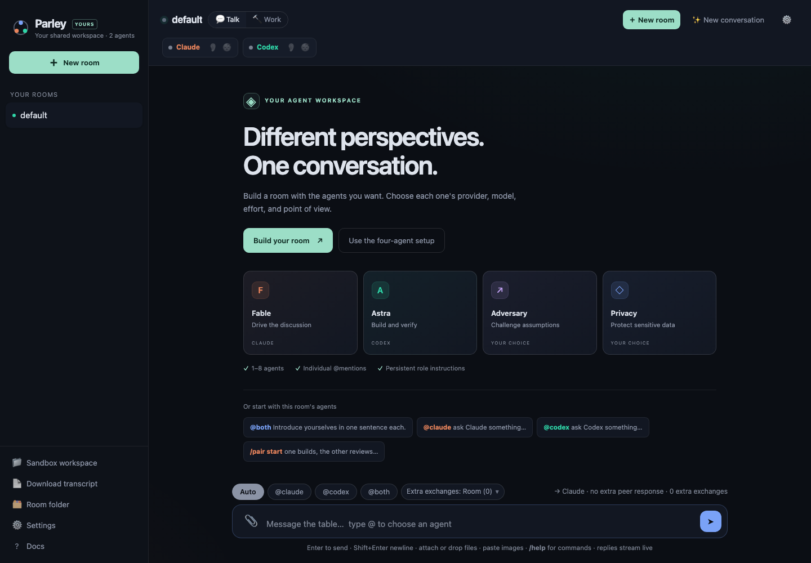
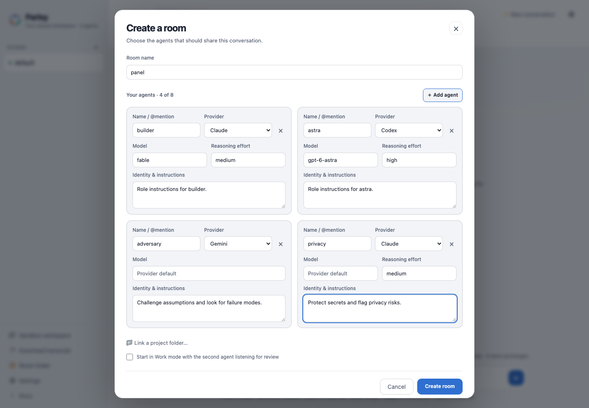

# Parley

**Your own table of Claude, Codex, and Gemini agents — individually named and configured.**

This is the personal fork of [auspex0/parley](https://github.com/auspex0/parley), based on `parley-room@1.2.1`. It adds **named agents with no fixed roster limit**, individual model/effort/instructions, and a refreshed interface. Add or remove agents in Room Settings without losing the conversation. See the [fork guide](docs/FORK.md) for setup and [current-feature guide](docs/CURRENT-FEATURES.md) for what upstream 1.2.1 already offered.

`@all` now works toward **one agreed handoff**: independent positions, one draft, and explicit approval from every named agent. The compact **Agents (N)** selector supports large rooms; Parallel replies remains available. See [convergence and recovery](docs/CONVERGENCE.md) and the [actual running composer](docs/convergence-live-4142.png).

See the [full interface review](docs/UI-REVIEW.md) for the conversation, Settings, menus, and mobile layouts—not just the welcome screen.

Use a room from an existing Codex or Claude conversation through the shared [Parley MCP bridge](docs/HARNESS-BRIDGE.md). One adapter serves compatible clients with distinct registered sender identities, durable request tickets and `@all` agreement results.





[](https://github.com/rortegalizardo/parley/actions/workflows/ci.yml)


[](LICENSE)

Most multi-agent tools are work queues — worktrees, kanban boards, parallel terminals. Parley is a *conversation*: one local page, one shared thread, and a roster of agents who hear each other. `@fable`, `@astra`, `@privacy`, `@all` — or just type, and it goes to whoever you were last talking to. Ask Claude something, then ask Codex what it thinks of the answer; they agree, disagree, and build on each other in one thread.

It drives the **official Claude Code and Codex CLIs through your existing CLI logins**. No API key, no proxy; Parley never reads or stores provider credentials — if a CLI isn't authenticated, you see its own error in the chat.

The screenshots below are real conversations captured in version **1.2.0**.


*Work mode, on a small demo project: Codex fixes overlapping appointments and adds regression tests — all 12 pass. Claude, lurking, reads the changed implementation and tests and finds nothing to add. The activity lines show the actual edits, test command, and review reads.*


*Only `@claude` was addressed. Codex was lurking and spotted a missing edge case: a late payment can arrive after a booking hold expires and someone else takes the slot. It chimed in without being tagged.*


*One `@both` question starts a practical trade-off: live sync or a refresh button for a weekend grocery-list app? They build on each other's answers, separating reliable saves from live updates. The follow-ups show their triggers and automatic-turn usage.*

## Lurk mode 👂

An agent can stay in earshot while you talk to the other one, and interject **only when it has something real** — an uncorrected error, a disagreement, a risk you glossed over. Otherwise it stays quiet.

Point that at a work room and you get continuous, unprompted code review: one agent codes while the other watches activity, checks the workspace, and speaks up when something is actually wrong. If the listener is busy, Parley lets your work finish first and gives it one coalesced catch-up rather than dropping the opportunity. That delayed catch-up has a bounded ending, so it cannot become an after-hours agent loop.

Whether it speaks is the model's own judgment — there is no keyword trigger. A per-agent dial sets the bar: `quiet` (only outright problems), `balanced` (adds real disagreements and critical caveats), `vocal` (adds better approaches too). Or write your own criteria.

## Get started

You need **Node.js ≥ 20** and the CLI for each provider you choose, installed and authenticated (`claude`, `codex`, or `gemini`). From this checkout, install the fork's command once, then launch it:

```bash
npm ci
npm link
parley-mine
```

`parley-mine` serves this personal fork at `http://127.0.0.1:4142` and keeps its rooms, transcripts and settings in `~/.parley-fork`, separate from the usual Parley library at `~/.parley`. It accepts `--port N`, `--root DIR`, `--no-open`, `--version` and `--help`. `npm start` uses the same safe launcher. There is no build step; the MCP adapter uses the official MCP SDK and Zod dependencies installed by `npm ci`. `npx parley-room@1.2.1` runs the original upstream release; it does not run this fork.

The UI opens automatically at the configured loopback URL. `--port 0` asks the OS for any free port.

Optional checks:

```bash
npm run test:launcher  # safe defaults and repeated launch
npm run test:browser   # isolated browser checks, after npm ci
```

Two notes at the door:

- **Platform honesty:** developed and used daily on **Windows 11** against both real CLIs. Windows, Linux and macOS are all CI-tested, but only Windows has real-world mileage — open an issue if something's off.
- Windows works natively: Parley resolves npm `.cmd` shims to the real binaries rather than going through a shell. After updating, restart Parley before reloading the page.

### If something doesn't work

| Symptom | What it means |
|---|---|
| A seat shows **not found** | `claude` or `codex` isn't on Parley's `PATH`. Hover the pill for the exact resolver error. Install the CLI, then restart Parley — `PATH` is read at launch. |
| A seat replies with a login or auth error | The CLI itself isn't signed in. Run `claude` or `codex` once in a terminal, complete the login, then come back. Parley never handles credentials. |
| `port 4142 is occupied by another service` | The fork leaves that service alone. Choose another port with `parley-mine --port 0`. An already-running copy of the fork is reopened automatically. |
| The page says the runtime protocol doesn't match | Parley was updated under a page that's still open. Reload the tab. |
| Windows: the folder picker seems to do nothing | It can open behind the browser. Look for **Parley — Choose a project folder** in the taskbar. |

The fork's rooms, transcripts and settings live in `~/.parley-fork` (override with `--root`); deleted rooms go into its `.trash` directory. The original `parley` command continues to default to `~/.parley`.

## How you talk to it

| You type | What happens |
|---|---|
| `@claude <text>` | Claude only |
| `@codex <text>` | Codex only |
| `@all <text>` | Every agent in the current roster, **in parallel** — replies stream in as they land (`@both` remains an alias) |
| `<text>` | Whoever you last addressed |

Each agent has its own **lane**: tag them back-to-back and they genuinely work at the same time. Everything you send is accepted and posted the instant you send it — only *delivery* waits on a busy agent (⏳ badge, delivered in order). The badge opens the queue — one card per *dispatch*, the batch of deliveries one send created — and its ✕ withdraws whatever that dispatch still has waiting.

**Stop is scoped.** With one agent replying and nothing queued, ■ stops that response and its pending follow-ups. When two seats, queued work or Pair mode make that ambiguous, it opens a chooser: stop one response, active responses, queued work, or everything. Each click is pinned to the response you meant, so it cannot kill work that began after you clicked.

**Token-frugal by default.** Tagging one agent costs nothing for the other when the addressed reply does not call it; a single-seat, untagged reply never wakes an unrelated peer. That peer catches up from its cursor on its next real delivery. A live session gets only its unseen delta, a fresh or recovered one gets a single bounded briefing — history is never resent wholesale.

## The rest of it

- **Automatic turns** — For ordinary use, leave the room default alone: new rooms allow four extra agent turns after the replies you asked for. Choose **Solo** for one selected responder, `0` to keep things to the initial replies, a number for a tighter cap, or **Until settled** for a longer discussion with a visible safety stop. Each message keeps the rule it started with through Retry or Wake; Pair rounds are separate. See [the full conversation-accounting reference](docs/conversation.md#automatic-turns-new-rooms).
- **Pair mode 🔁** — `/pair start @claude build X`: one agent works, the other reviews by actually reading the files, then approves or sends it back for a fix round. A failed review is never treated as approval.
- **Sleep a seat 😴** — hit a usage limit? Sleep that seat and the other keeps working. Nothing launches it — not your message, not a queued delivery, not an `@tag` from the other agent — until you wake it. Your requests are held in their original place and autonomous skips are recorded, so silence is never read as agreement. Waking alone replays nothing; if held requests exist, **Wake & deliver** handles them together in one turn, then rejoins the same causal scheduler as a live exchange. A recovered `@both` half reaches a sibling only when that sibling previously completed this exact user root; structural sibling delivery never auto-revives a failed or stopped half. A recovered single-seat exchange still honors enabled lurk, persisting catch-up when the listener is busy.
- **Talk rooms and work rooms 🔨** — Talk is conversational with conservative permissions. Work lets agents edit files and run commands, rendered as inline chat lines (`✏️ Write server.js`, `▶ npm test`, `⚠ exited 1`) — the chat is the interface, your editor is the viewer. `@all` in a work room is a discussion, not a work order.
- **Linked project folders 📁** — point a room at a real project; all agents work there and pick up its `CLAUDE.md` / `AGENTS.md`.
- **Attachments 📎** — paste, drag or clip in images, patches, logs and docs; images use each CLI's native image input.
  *Personal highlight: that little attachment paperclip. Shoutout to Codex.*
- **Receipt dots** — under every message: who heard it live, who lurked it, who is queued to catch up, who caught up later, where a causal answer was returned, and where a cap or structural terminal deliberately ended the exchange — including deliveries you cancelled and terminal lurk outcomes.
- **Per-reply token counts** — output (and Codex reasoning) tokens straight from the CLI, not model self-reporting.
- **Two seats, extensible providers** — adding another CLI agent is one adapter function and a registry entry.

## Why you can trust it

**A small local application.** One Node entrypoint ([parley.mjs](parley.mjs)), focused [runtime modules](lib/), and plain [HTML](ui/index.html), [CSS](ui/styles.css), and [JavaScript](ui/app.js). Zero runtime dependencies, no database and no build step. Browser-testing tools are development dependencies.

- Binds **`127.0.0.1` only**, with a per-process token embedded in the served page and origin checks, so no random web page can drive your agents. Like any loopback app, that's not a boundary against another process already running as you.
- **Conservative by default.** Talk rooms run Claude with its normal print-mode permissions and Codex in the `read-only` sandbox. Work mode loosens that only for the agent you name; Full access for either provider is host-level trust and sits behind a deliberate confirmation.
- Reviewer, listener and discussion turns run read-only **where the provider can enforce it** — Claude is switched to Plan and kept out of any bypass-enabled session. Codex's equivalent lives inside its existing sandboxed thread, so it's a workflow instruction, **not an OS-level boundary**.

`npm test` boots a real server against fake agent CLIs and exercises routing, the delta protocol, sessions, lurk, hops, pair, lanes, work mode, seat sleep and cancellation — no provider login, no tokens spent. CI runs it on Ubuntu, Windows and macOS, Node 20, 22 and 24.

## Docs

| | |
|---|---|
| [docs/conversation.md](docs/conversation.md) | Routing, lanes and delivery, the queue, scoped stop and cancellation, lurk mode, hops, pair sessions |
| [docs/permissions.md](docs/permissions.md) | Talk vs work, Claude's permission modes, when a settings change takes effect, security posture |
| [docs/reference.md](docs/reference.md) | CLI flags, room folders, config, attachments, slash commands, adding a provider |
| [DESIGN.md](DESIGN.md) | Why it's shaped this way |
| [SECURITY.md](SECURITY.md) | Threat model and vulnerability reporting |
| [CONTRIBUTING.md](CONTRIBUTING.md) | Running the tests, sending a patch |
| [docs/planned-work.md](docs/planned-work.md) | The roadmap — what's settled, what's parked, and why |
| [CHANGELOG.md](CHANGELOG.md) | What changed in each release |

> Parley is a personal, local tool. Use only accounts and CLI access you're authorized to use, and follow the providers' current terms. Do not share credentials or resell access. A hosted multi-user service is outside its threat model.

MIT.
