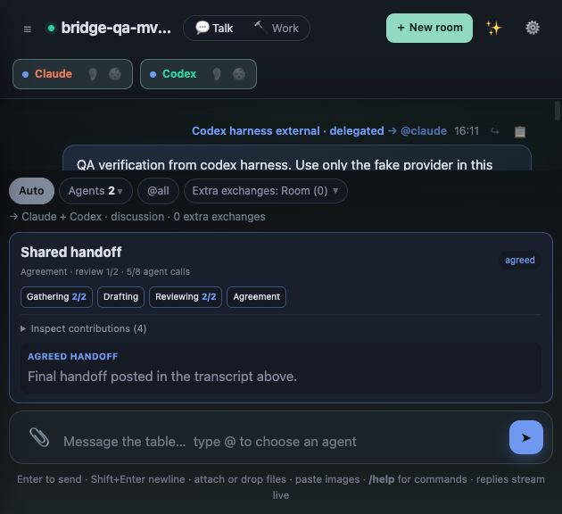

# MCP bridge verification — 2026-10-22

Implementation: Sol 6.1 workers. Review, integration checks and actual 4142 validation: primary agent. Repository: `rortegalizardo/parley`; delivery branch: `main`.

## Results

| Check | Result |
| --- | --- |
| Unit suite | 16 passed |
| Existing integration suites | Passed: retry, provenance, scheduler sequences, automatic turns, Claude sessions, multi-agent rooms, roster edits, launcher isolation and convergence |
| Smoke | 839 passed, 0 failed on corrected code |
| Browser | 42 passed after final sender/target display changes |
| `npm run test:bridge` | Passed adapter, backend, lifecycle and independent SDK end-to-end checks |
| Final independent E2E | Passed, including duplicate pending submissions, restart/reset, unresolved and incomplete results |
| Package | Packed server and adapter start with production dependencies installed |
| Installed Codex | Temporary-config app-server connected, discovered four tools, executed authenticated room-list and transcript-read tools; no model turn |
| Installed Claude Code | Temporary local registration completed the MCP connection health check; no model turn |
| Actual fork | Named requests from both registered identities and exact `@all` handoff/reservations passed on 4142 with fake providers |

The SDK tests exercise real stdio protocol traffic through the shared adapter into a real Parley backend and fake provider processes. Claude's installed-client check proves connection compatibility; its actual model was not asked to choose or invoke a tool. The Codex check calls tools directly through its app-server interface. No paid model calls were made.

Security and reliability checks cover room scope, forged sender metadata, Host/Origin/protocol/token rejection, cross-client ticket/cursor isolation, secret redaction, protected paths/port, inherited-provider loop guards, stale rosters/conversations, busy convergence, replay prevention, exact approved text, reservations, interrupted runs and resumed convergence. A completed but unpolled handoff survives restart followed by a UI conversation reset.

## Live UI and isolation

Only the fork on **4142** was refreshed, after checking process ownership and room inactivity. Last observed PID: `54615`. Runtime protocol: `14`. UI version: `ed9452f70611a6987d97`.

The actual in-app browser showed distinct Codex/Claude harness badges, source-aware reply quotes, `@all`, an agreed handoff, its approval record and both reservations. Inspection caught and corrected two misleading labels (`@both` and “your message” on external requests). The final browser suite passed after those corrections.

QA room `bridge-qa-mvk3j5n4-af98c6` used only a dedicated fake-provider wrapper, configured before the first message. After verification it was moved into recoverable room trash, its two scoped credentials revoked, and its temporary provider removed. The browser was returned to the existing default room. The existing transcript hash and full room configuration matched their pre-validation snapshots.

**Port 4141 was not contacted, signaled, restarted or reconfigured, and its library was not modified.** No normal/global harness configuration was installed. The bridge is available on 4142; the caller chooses the project and room scope when following the [setup guide](HARNESS-BRIDGE.md).

An early smoke process loaded an intermediate source version and found six related Ask/Stop-and-Ask failures from an out-of-scope variable. That insertion was removed. The later full smoke passed all 839 checks, and the primary agent independently retested explicit Ask, default Ask text and Stop-and-Ask against corrected code.

## Subsequent requested harness installation

The user later explicitly requested installation. Both Codex and Claude now have user-scope `parley` registrations for the same adapter, with separate credentials restricted to `default` on 4142. No central multi-service gateway or duplicate MCP project was created.

Before installation, Sol 6.1 added an ancestry guard that detects original and fork Parley provider contexts before credential access. Such contexts expose zero tools and reject direct calls; unknown/unsupported ancestry is also suppressed. A real fake-original subprocess test verifies this without an environment marker or credential file. This protects normal inherited-provider execution, not deliberately detached same-user processes.

The primary agent ran the full bridge suite (8 checks plus independent end-to-end cases) and packaged startup (22 files), verified the persisted Codex registration, observed Claude's actual user-scope Connected status, and repeated Codex app-server discovery/read with the installed credential. Process-metadata-only checks confirmed the actual original and fork ancestor contexts are suppressed while the normal harness context is allowed. Neither server was restarted, no message was submitted, and no 4141 API or library was accessed. Existing sessions may need a fresh harness connection to load their newly installed tools.
