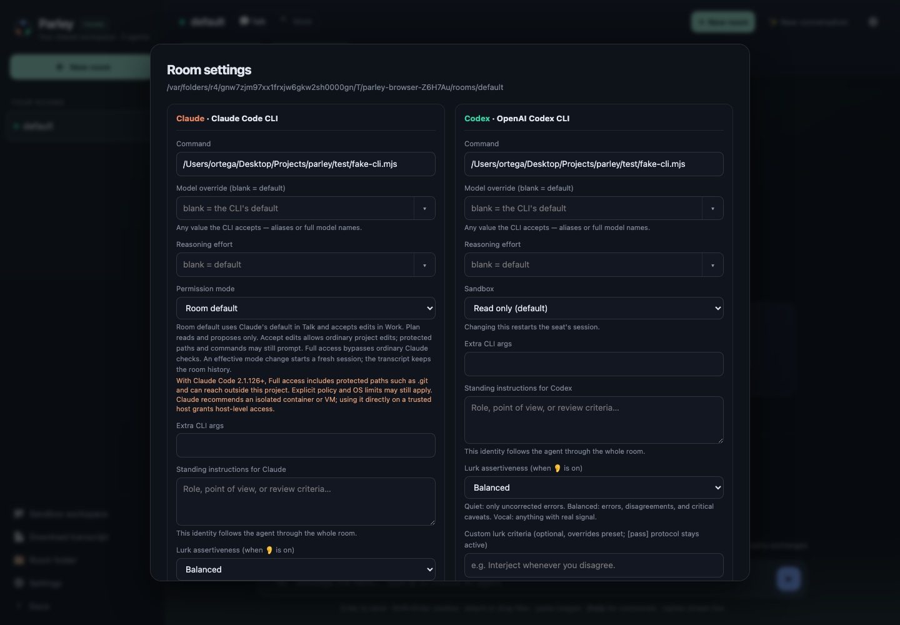
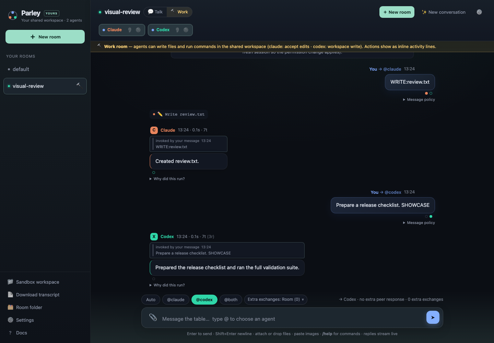

# UI review

**Status:** 36 browser checks and the package check passed. This review covers the 15 user-facing surface groups below; it does not claim every possible state combination or real provider behavior was tested.

The screenshots were captured with an isolated fixture and fake-provider content. The actual fork on port 4142 was refreshed while idle and verified to serve the exact tested UI assets (`c26c0efb58c00b61f693`); its Settings panel was also checked in the in-app browser. The original session on 4141 was left untouched. Native OS folder-picker and browser permission UI are platform-owned and retain their platform appearance; their entry points were inventoried, and browser confirm/cancel flows were tested. Native OS pickers and permission prompts were not invoked.

| Surface | Reviewed states and fixes | Evidence (test; capture) |
|---|---|---|
| App shell and header | Desktop/mobile header, compact viewport, dark/light theme, room actions. | `test/browser-roster.mjs`; [conversation dark, 1440](ui-review/conversation-dark-1440.png), [conversation light, 390](ui-review/conversation-light-390.png) |
| Sidebar and room list | Room list, switching, mobile drawer, settings entry. | `test/browser-roster.mjs`; [mobile sidebar](ui-review/mobile-sidebar-open.png), [settings from sidebar](ui-review/settings-from-mobile-sidebar-dark-390.png) |
| Empty room and welcome | Build-room calls to action and four-agent entry at desktop and phone sizes. | `test/browser-roster.mjs`; [four-agent setup, 390](ui-review/new-room-four-dark-390.png) |
| Transcript and reply states | Conversation, streaming, error recovery and retry presentation. | `test/browser.mjs`; [conversation dark, 1440](ui-review/conversation-dark-1440.png), [error recovery](ui-review/error-recovery-dark-1440.png) |
| Pair mode | Active Pair banner and compact viewport layout. | `test/browser.mjs`; [Pair active, 390](ui-review/pair-active-dark-390.png) |
| Composer recipients and routing | Composer sizing, mention picker, route feedback. | `test/browser-roster.mjs`, `test/browser-policy.mjs`; [mention picker](ui-review/mention-picker-mobile.png) |
| Continuation policy | Policy choices and mobile popover positioning. | `test/browser-policy.mjs`, `test/browser-roster.mjs`; [mobile continuation menu](ui-review/hop-menu-mobile.png) |
| Busy strip and stop controls | Active response, stop scopes and mobile stop menu. | `test/browser.mjs`, `test/browser-fixture.mjs`; [mobile stop menu](ui-review/stop-menu-mobile.png) |
| Queue popover | Queued Pair recovery and mobile popover. | `test/browser-panels.mjs`; [mobile queue](ui-review/queue-popover-mobile.png) |
| Ask and wake menus | Desktop ask/wake menu presentation and available actions. | `test/browser-panels.mjs`; [ask menu](ui-review/ask-menu-desktop.png), [wake menu](ui-review/wake-menu-desktop.png) |
| Attachments and draft state | Drafted and cleared attachment presentation. | `test/browser-panels.mjs`; [drafted attachments](ui-review/attachments-drafted.png), [cleared attachments](ui-review/attachments-cleared.png) |
| New-room dialog and roster | Two/four/eight-seat layouts, phone layout, focus, dismissal and creation. | `test/browser-roster.mjs`, `test/browser.mjs`; [four agents, light](ui-review/new-room-four-light-390.png), [eight agents](ui-review/new-room-eight-dark-390.png) |
| Settings modal and subcontrols | Desktop/phone, dark/light, open selectors, lower fields, instructions and persistence. | `test/browser-dialogs.mjs`, `test/browser-roster.mjs`; [settings dark, 1440](ui-review/settings-dark-1440.png), [settings light, 390](ui-review/settings-light-390.png) |
| Runtime, setup, Pair and Work banners | Warning banner visibility, wrapping and themed foregrounds. | `test/browser-visual.mjs`; [runtime warning](ui-review/runtime-warning-dark-390.png), [setup warning](ui-review/setup-warning-dark-390.png) |
| Confirm, prompt and native picker surfaces | Browser confirmation acceptance/cancellation; platform-owned picker and permission UI noted above. | `test/browser-dialogs.mjs`; no native picker capture |

The full 36-check browser suite and package check passed. The conversation/banner suite passed again after the final Work contrast change, including long formatted code content at phone width. Captures disable transient animations so the reviewed images show settled states.

